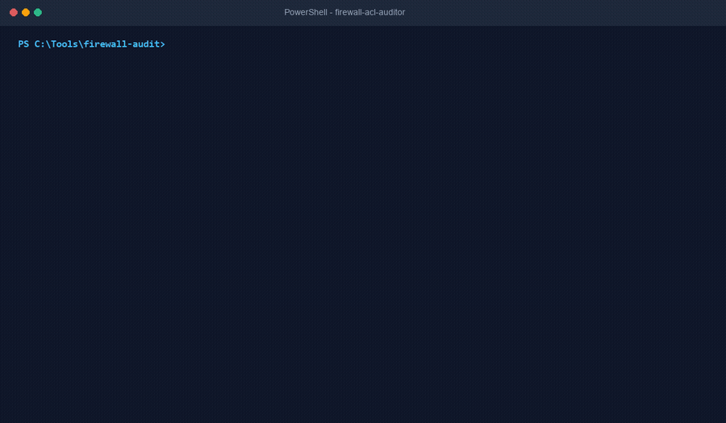

# Multi-Vendor Firewall & ACL Conflict Auditor (`firewall-acl-auditor`)



[](https://github.com/ToritsejuBoyo/firewall-acl-auditor/actions/workflows/tests.yml)
[](LICENSE)
[]()
[-brightgreen.svg)](CONTRIBUTING.md)
[](SECURITY.md)
[](https://agentskills.io)

> An HD recording is available in [`assets/demo.mp4`](assets/demo.mp4).

Deterministic multi-vendor firewall and access-list (ACL) conflict auditor for **Cisco ASA / IOS**, **Fortinet FortiGate (FortiOS)**, and **MikroTik RouterOS**. Normalizes disparate firewall exports into a canonical packet-space schema, mathematically detects shadowed and redundant rules using pure bitwise subnet math, and generates vendor-accurate CLI cleanup commands with atomic rollback scripts.

Zero external dependencies. Python standard library only.

---

## 1. Executive Summary & Stakeholder Briefing

### The One-Sentence Pitch
A zero-dependency, multi-vendor firewall and ACL conflict auditor that normalizes Cisco ASA, Fortinet FortiGate, and MikroTik RouterOS rule exports into a unified view, deterministically detects shadowed and redundant rules, flags dangerous any-any exposures, and outputs change-ready CLI cleanup and rollback scripts.

### The Real-World Problem
Enterprise firewalls inevitably suffer from rule bloat. Over years of operations, emergency change tickets, infrastructure migrations, and departed administrators leave behind thousands of accumulated rules. In production:
1. **Completely Shadowed Rules:** A broader rule positioned earlier in the evaluation order intercepts traffic first, rendering subsequent rules unreachable dead code or silently bypassing intended security restrictions.
2. **Redundant Duplicate Rules:** Duplicate rules granting identical permissions as preceding rules degrade firewall policy evaluation latency and cause administrative confusion.
3. **Overly Permissive ("Any-Any") Rules:** Unrestricted inbound rules or wide-open exposure of administrative services (Telnet, RDP, SSH, SMB, WinBox) trigger immediate audit failures during PCI-DSS, SOC 2, and ISO 27001 assessments.

Manually untangling multi-vendor firewall rulebases in spreadsheets takes network engineers days of tedious, error-prone subnet calculation.

### The 3-Step Walkthrough
```
[ Step 1: Export Config ]  -->  [ Step 2: Local Deterministic Audit ]  -->  [ Step 3: Change-Ready Remediation ]
Cisco / FortiGate / MikroTik      Pure Python Subnet Containment Engine       Prioritized Findings + Safe Rollback CLI
(Offline Text/JSON Export)       RFC 5737 IP Masking (--sanitize)             Cisco / Fortinet / MikroTik Native CLI
```

1. **Step 1: Export Config:** The network engineer exports standard firewall configuration text or JSON from Cisco ASA (`show running-config access-list`), Fortinet FortiGate (`config firewall policy`), or MikroTik RouterOS (`/ip firewall filter export`).
2. **Step 2: Local Deterministic Audit:** The engineer runs the standalone audit tool locally with `--sanitize`. Using Python's native `ipaddress` library, the tool performs bitwise packet-space containment math on their workstation. Zero internal IP addresses or company telemetry leave the local machine.
3. **Step 3: Change-Ready Remediation:** The tool outputs a prioritized diagnostic report and vendor-tailored CLI commands to reorder or prune rules, complete with exact reverse rollback commands for ITIL change management approval.

### Why IT Leadership Approves (CISO & IT Operations)
* **Zero External Dependencies:** Built 100% on Python standard library modules (`ipaddress`, `json`, `argparse`, `re`, `hashlib`). No `pip install`, no compiled binaries (`.exe`/`.dll`), and no unauthorized background services.
* **100% Read-Only & Offline:** Operates strictly on exported configuration files. Never initiates outbound network connections or automated writes to production firewalls.
* **Zero PII & Network Topology Leakage:** The `--sanitize` mode masks internal IPv4/IPv6 address space into RFC 5737 test ranges (`192.0.2.0/24`, `198.51.100.0/24`, `203.0.113.0/24`) and strips all secret keys/passwords before any text is reviewed or fed to an LLM.
* **Audit-Proof Rollback:** Every recommended modification is paired with an exact reverse command, satisfying strict Enterprise Change Advisory Board (CAB) requirements.

---

## 2. Comparison Matrix

| Feature / Capability | Enterprise Suites (Tufin, AlgoSec, FireMon) | Vendor Native CLIs (Cisco packet-tracer, FortiGate lookup) | Raw ChatGPT / LLM Prompting | What We Built (`firewall-acl-auditor`) |
| :--- | :--- | :--- | :--- | :--- |
| **Cost & Licensing** | \$50,000 - \$250,000+/year | Free with hardware | Subscription fee | **100% Free & Open-Source (MIT)** |
| **Deployment Overhead** | Heavy appliances, SQL DBs, agent collectors | None (on-device only) | None | **Instant (< 5 seconds, zero install)** |
| **Multi-Vendor Normalization** | Yes (heavy proprietary collectors) | Single-vendor silo | Inconsistent | **Unified: Cisco ASA/IOS, FortiGate, MikroTik** |
| **Subnet Math Precision** | Deterministic | Single-packet probe only | Prone to arithmetic hallucination | **Deterministic bitwise containment (`ipaddress`)** |
| **Network Data Privacy** | Internal database cluster | Local device | Leaks internal network topology to public LLMs | **Client-side RFC 5737 masking (`--sanitize`)** |
| **Atomic Rollback CLI** | Complex workflow integration | None | Generic suggestions | **Exact, copy-paste vendor-specific rollback scripts** |

---

## 3. Key Features at a Glance

* **Multi-Dimensional Packet Space Engine:** Implements the Al-Shaer packet containment algorithm across 5 dimensions: Source IP, Destination IP, Protocol, Source Port, and Destination Port.
* **Multi-Vendor Normalization:** Automatically recognizes and parses Cisco ASA / IOS extended ACLs, Fortinet FortiGate firewall policies, MikroTik RouterOS `/ip firewall filter` chains, and normalized JSON.
* **Shadowing vs. Redundancy Differentiation:** Distinguishes between critical shadowing (where an earlier permit hides a subsequent deny exception) and redundant duplicate bloat (where an earlier rule already grants the same access).
* **Security Hygiene Auditing:** Flags unrestricted `permit ip any any` rules, detects WAN-exposed high-risk management ports (Telnet 23, SSH 22, RDP 3389, SMB 445, WinBox 8291), and warns of inactive/disabled zombie rules.
* **MikroTik Implicit Drop Verification:** Detects when MikroTik forward or input filter chains omit a final drop rule, exposing networks to RouterOS's dangerous default implicit accept behavior.
* **Change-Ready Remediation & Rollback:** Generates vendor-accurate reordering commands (`resequence` on Cisco, `move before` on FortiGate, `move [find]` on MikroTik) and corresponding rollback scripts.
* **Automated Data Sanitization:** Scrubs pre-shared keys and passwords, and deterministically translates private and public subnets into RFC 5737 documentation blocks.

---

## 4. Supported Firewall Vendors

### Cisco ASA & IOS / IOS-XE
* Supported formats: `access-list <NAME> extended permit|deny ...` or `ip access-list extended <NAME>`.
* Identifies host, subnet masks (`255.255.255.0`), and Cisco inverted wildcard masks (`0.0.0.255`).
* Generates Cisco `resequence` and `line <N>` insertion commands.

### Fortinet FortiOS (FortiGate)
* Supported formats: `config firewall policy ... edit <ID> ... set ... next ... end`.
* Parses interface bindings (`srcintf` -> `dstintf`), named services, and schedule parameters.
* Generates `move <ID> before <ID>` reordering commands and atomic rollback CLI.

### MikroTik RouterOS (v6 & v7)
* Supported formats: `/ip firewall filter export` or `add chain=... action=...`.
* Evaluates `input`, `forward`, and `output` chains.
* Emits critical alerts for chains lacking an explicit terminal drop rule.

---

## 5. Installation & Setup Guide

### Prerequisites
* Python 3.10 or higher (standard library only; no external packages required).
* Any operating system: Windows, macOS, or Linux.

### Option 1: Git Clone
```bash
git clone https://github.com/ToritsejuBoyo/firewall-acl-auditor.git
cd firewall-acl-auditor
python tests/validate-skill.py
```

### Option 2: Single-Script Standalone Download
To run the auditor immediately without cloning the entire repository:

**Linux / macOS:**
```bash
curl -fsSL https://raw.githubusercontent.com/ToritsejuBoyo/firewall-acl-auditor/main/scripts/audit-firewall-rules.py -o audit-firewall-rules.py
python3 audit-firewall-rules.py --help
```

**Windows (PowerShell):**
```powershell
Invoke-WebRequest -Uri "https://raw.githubusercontent.com/ToritsejuBoyo/firewall-acl-auditor/main/scripts/audit-firewall-rules.py" -OutFile "audit-firewall-rules.py"
python audit-firewall-rules.py --help
```

### Option 3: Integration into AI Agent Environments
* **Antigravity / Cursor / Claude Code:** Place this repository into your workspace `skills/firewall-acl-auditor/` directory. The AI assistant will automatically read `SKILL.md` and execute `audit-firewall-rules.py` when auditing network configurations.
* **ChatGPT Custom GPT:** Upload `SKILL.md` as knowledge and configure the script output as instructions for firewall audit analysis.

---

## 6. Local Hands-On Testing Walkthrough

You can test the entire workflow locally on your workstation using the bundled synthetic fixtures without needing access to a live firewall or production network.

### Test 1: Run the Automated Verification Suite
Verify that all 7 test suites pass with exit code 0:
```bash
python tests/validate-skill.py
```

### Test 2: Audit a Cisco ASA Configuration with Shadowed Rules
Audit an export containing shadowed denial rules, redundant HTTP permits, and overly permissive any-any rules:
```bash
python scripts/audit-firewall-rules.py -i tests/fixtures/fixture-cisco-asa-shadowed.txt --sanitize
```

### Test 3: Audit a Fortinet FortiGate Policy with Safe Rollback
Inspect FortiGate policies and generate `move before` CLI commands:
```bash
python scripts/audit-firewall-rules.py -i tests/fixtures/fixture-fortigate-redundant.txt --sanitize
```

### Test 4: Audit MikroTik RouterOS for Implicit Accept Vulnerabilities
Audit MikroTik filter chains for missing explicit terminal drop rules:
```bash
python scripts/audit-firewall-rules.py -i tests/fixtures/fixture-mikrotik-any-any.rsc --sanitize
```

### Test 5: Export JSON for CI/CD Pipeline Automation
Output findings in structured JSON for integration into GitHub Actions, GitLab CI, or ServiceNow change tickets:
```bash
python scripts/audit-firewall-rules.py -i tests/fixtures/fixture-cisco-asa-shadowed.txt --format json
```

---

## 7. Automated Test Suite Summary

The included test harness (`tests/validate-skill.py`) deterministically validates:
1. **Cisco ASA Parser:** Detects shadowed denial rules, redundant permits, insecure ports, and any-any permits.
2. **FortiGate Parser:** Validates policy reordering and inverse rollback CLI generation.
3. **MikroTik Parser:** Verifies filter chain analysis and flags missing explicit drop rules.
4. **Normalized JSON Schema:** Validates cross-vendor canonical ingestion.
5. **Bitwise Subnet Math:** Tests arbitrary prefix containment (`/24` in `/16`, `/25` in `/24`, disjoint subnets).
6. **Data Sanitization (Rule 4):** Ensures all internal subnets are translated to RFC 5737 test prefixes and passwords are scrubbed.
7. **agentskills.io Specification Compliance:** Verifies `SKILL.md` frontmatter and zero third-party packages.

---

## 8. License

This project is licensed under the MIT License - see the [LICENSE](LICENSE) file for details.
